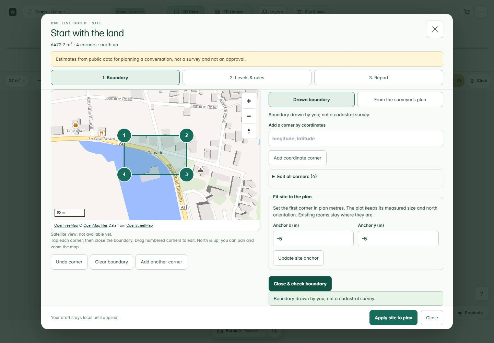
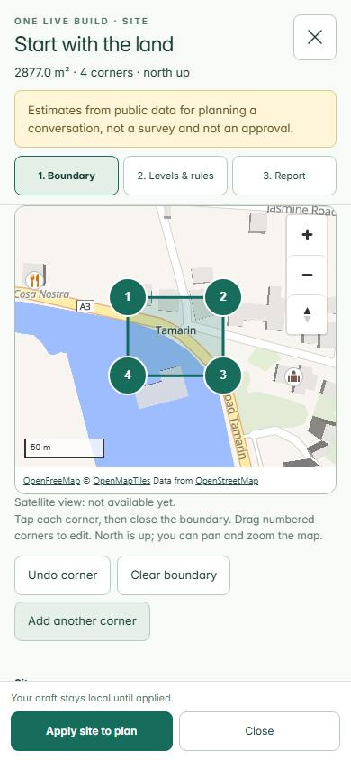

# Site — World fix round 1

PR [#54](https://github.com/victorcassiusoffice-sketch/ppw-designer-2d/pull/54). Measured code **2c6743a1a00fea395556358d011fa323b81b0018**. Date 28 October 2026. Regular CI passes 4,402 tests / 408 files; final documentation-only head is in the handoff. **Not merge-ready under the literal static gate.** No merge/manual deployment authorized.

## Changes and focused proof

Canonical validation moved behind picture/plan paint. Original 3 persistence cases retained; new tests cover late imports/rehydration, invalid payloads, no-site bytes, disposal, query-first3D boundary and focus while verifying preview.

Real preview **/demo?site=1&live=1**, then Site: 1440 × 1000 desktop and 390 × 844 phone map, three fully visible credit links, explicit Tamarin search with 5 results, four-corner drawing and report passed. Arbitrary demonstration outlines measured 6,472.73 m² / 2,876.98 m²; they are not verified land parcels. Offline hint exact and 0 credit DOM / 0 provider calls. Simulated env=production on the preview stayed offline; actual production has not been changed.

Retained saved-world trace at 017e16d: first picture 4,794.5 ms; hydration starts 6,656.9 ms. Valid world retained and canary removed in final inspection. The 8 s poll expired before that inspection and is recorded; no claim that hydration completes immediately. No-world: picture 4,192 ms and 0 implementation requests.

Final 2c6743a smoke: seven cases passed, including delayed initial SiteEntry loading at both sizes. Cancel received focus, the background stayed inert, Delete/click left it unchanged, Escape closed the waiting dialog, and late download completion did not reopen it. Zero page/console/HTTP errors and zero attempted, blocked or transmitted network writes. Details: preview-smoke.json, hydration-preview.json and harness scripts.

## Static gate and first-picture network

Controlled build against 3eefbf7 uses identical existing VERCEL_ENV=preview and VERCEL_GIT_COMMIT_SHA=3eefbf7 variables, no configuration changes. App+ThreeStage closure: 28 JS files: **+2570 raw/+953 gzip**. Early propertyStore 88,676 raw / 29,855 gzip versus 88,628 / 29,835 base; canonical validator removed, opaque preservation remains. This is a literal **FAIL**, not a rounded-KB pass. Hashed names change transitively; gzip can vary from those hash strings even at identical raw length.

Actual network comparison: **0 separate implementation-chunk requests before picture**, new normalized request paths: **/fonts/fraunces-600-latin.woff2, /fonts/outfit-latin.woff2**. All request starts, including unfinished responses, are included. Observed-file full comparison totals: +3759 raw/+1306 gzip. API response sizes remain variable and are in raw traces.

Unchanged server/brand.ts and middleware.ts serve index.html (PPW) on the specified production vercel.app address, olb.html (OLB) on previews and onelivebuild.com. OLB alone preloads Fraunces and Outfit fonts. Required formal timing URLs were not changed. These two extra request paths are inherited shell routing, not World feature requests. Custom-domain comparisons remain informational.

Against the custom domain, additional normalized request paths: **none**. The controlled same-shell comparison (OLB HTML against OLB HTML, including matching observed JS/CSS/public files) is **+2570 raw / +957 gzip bytes**. The table below maps each actual route to its inherited HTML shell; font files marked “present, not requested” exist in base but were not fetched on its PPW shell. These are completed Vite output bytes after preload transforms, not network compression estimates. The earlier generateBundle-hook audit was superseded because it ran before final Vite transformations. Across the actual requested static assets, including the inherited extra fonts and different HTML shell, the raw-size difference is +53223 bytes; variable API responses are excluded. Original request/response sizes remain in the network JSON. See STATIC-CONSTRAINT.md for the remaining integration requirement.

| Early file / endpoint | Base emitted name | Base bytes / gzip | Candidate emitted name | Candidate bytes / gzip | Raw file delta |
|---|---|---:|---|---:|---:|
| /api/products | API response | network trace | API response | network trace | variable |
| /assets/App.css | assets/App-Xhd2x0gp.css | 207222 / 38005 | assets/App-Xhd2x0gp.css | 207222 / 38005 | 0 |
| /assets/App.js | assets/App-CROjg-sG.js | 1062179 / 327162 | assets/App-BC73Fc1c.js | 1064701 / 328100 | 2522 |
| /assets/CurrencySwitcher.js | assets/CurrencySwitcher-DAGBomCy.js | 2642 / 1447 | assets/CurrencySwitcher-0jH_I1Lj.js | 2642 / 1447 | 0 |
| /assets/DemoDesignerPage.js | assets/DemoDesignerPage-DLqO3W61.js | 4846 / 2371 | assets/DemoDesignerPage-S-dn1aaP.js | 4846 / 2373 | 0 |
| /assets/LocaleThemeControls.js | assets/LocaleThemeControls-BRZbV6iy.js | 3170 / 1309 | assets/LocaleThemeControls-BaTf4Ke6.js | 3170 / 1309 | 0 |
| /assets/RequireMerchant.js | assets/RequireMerchant-BvJGo3r3.js | 5153 / 2292 | assets/RequireMerchant-BvJGo3r3.js | 5153 / 2292 | 0 |
| /assets/ThreeStage.js | assets/ThreeStage-xnIYIUoq.js | 93555 / 32821 | assets/ThreeStage-bvcDhHMR.js | 93555 / 32822 | 0 |
| /assets/buildSkinStore.js | assets/buildSkinStore-DBtXvGgt.js | 744 / 462 | assets/buildSkinStore-CjfdDvXe.js | 744 / 461 | 0 |
| /assets/buildingServices.js | assets/buildingServices-D7eQkhKr.js | 175717 / 51250 | assets/buildingServices-nIafiqBC.js | 175717 / 51248 | 0 |
| /assets/buildingServicesCatalog.js | assets/buildingServicesCatalog-gFhvLWEg.js | 6105 / 2573 | assets/buildingServicesCatalog-gFhvLWEg.js | 6105 / 2573 | 0 |
| /assets/cartStore.js | assets/cartStore-DfhgqqhS.js | 12564 / 4558 | assets/cartStore-BrE_nC_E.js | 12564 / 4554 | 0 |
| /assets/commission.js | assets/commission-BSjTNLTx.js | 52 / 72 | assets/commission-BSjTNLTx.js | 52 / 72 | 0 |
| /assets/currency.js | assets/currency-TeQzs54S.js | 325 / 251 | assets/currency-BOeuon9S.js | 325 / 251 | 0 |
| /assets/designsApi.js | assets/designsApi-vmM8Eco8.js | 16071 / 5352 | assets/designsApi-CcrtXjH3.js | 16071 / 5350 | 0 |
| /assets/downloadJson.js | assets/downloadJson-DhXa1J4E.js | 276 / 233 | assets/downloadJson-DhXa1J4E.js | 276 / 233 | 0 |
| /assets/embedMessages.js | assets/embedMessages-BIa44F5a.js | 716 / 319 | assets/embedMessages-BIa44F5a.js | 716 / 319 | 0 |
| /assets/main.css | assets/main-CO6GBvCf.css | 73032 / 14288 | assets/main-CO6GBvCf.css | 73032 / 14288 | 0 |
| /assets/main.js | assets/main-DvO__g69.js | 86230 / 31101 | assets/main-D7T32VgD.js | 86230 / 31104 | 0 |
| /assets/merchantFurniture.js | assets/merchantFurniture-ZuMdbwJD.js | 2710 / 1372 | assets/merchantFurniture-ZuMdbwJD.js | 2710 / 1372 | 0 |
| /assets/middleware.js | assets/middleware-BoNmX9tp.js | 3758 / 1361 | assets/middleware-BoNmX9tp.js | 3758 / 1361 | 0 |
| /assets/modelSnapshot.js | assets/modelSnapshot-GOA-nC4t.js | 5351 / 2392 | assets/modelSnapshot-JklrJmbh.js | 5351 / 2393 | 0 |
| /assets/productImageSafety.js | assets/productImageSafety-CDXX3Z8N.js | 434 / 292 | assets/productImageSafety-CDXX3Z8N.js | 434 / 292 | 0 |
| /assets/productSurfaceLighting.js | assets/productSurfaceLighting-Cl084EKV.js | 37533 / 14014 | assets/productSurfaceLighting-1Df_PIDz.js | 37533 / 14015 | 0 |
| /assets/propertyStore.js | assets/propertyStore-DAzV58D0.js | 88628 / 29835 | assets/propertyStore-DoifMOi0.js | 88676 / 29855 | 48 |
| /assets/quotedProducts.js | assets/quotedProducts-2NCXztC6.js | 392 / 265 | assets/quotedProducts-2NCXztC6.js | 392 / 265 | 0 |
| /assets/renderQualityStore.js | assets/renderQualityStore-DinSqPpH.js | 27262 / 10881 | assets/renderQualityStore-DLZqEu5t.js | 27262 / 10880 | 0 |
| /assets/serviceFixtureMeshes.js | assets/serviceFixtureMeshes-dDaBzpGO.js | 4351 / 1883 | assets/serviceFixtureMeshes-dDaBzpGO.js | 4351 / 1883 | 0 |
| /assets/showcaseSafety.js | assets/showcaseSafety-DFBXsUeQ.js | 179 / 162 | assets/showcaseSafety-DFBXsUeQ.js | 179 / 162 | 0 |
| /assets/types.js | assets/types-BR-OoGj9.js | 54910 / 12621 | assets/types-BR-OoGj9.js | 54910 / 12621 | 0 |
| /assets/vendor-konva.js | assets/vendor-konva-CbK8OvmD.js | 292561 / 89264 | assets/vendor-konva-CbK8OvmD.js | 292561 / 89264 | 0 |
| /assets/vendor-react.js | assets/vendor-react-CS4MHxMm.js | 142362 / 45622 | assets/vendor-react-CS4MHxMm.js | 142362 / 45622 | 0 |
| /assets/vendor-router.js | assets/vendor-router-YSxUxVSZ.js | 21566 / 8036 | assets/vendor-router-YSxUxVSZ.js | 21566 / 8036 | 0 |
| /assets/vendor-three.js | assets/vendor-three-CjQotlrx.js | 744964 / 191245 | assets/vendor-three-CjQotlrx.js | 744964 / 191245 | 0 |
| /brand/olb/olb-mark.svg | public/brand/olb/olb-mark.svg | 401 / 269 | public/brand/olb/olb-mark.svg | 401 / 269 | 0 |
| /demo | index.html | 964 / 494 | olb.html | 2153 / 844 | 1189 |
| /fonts/fraunces-600-latin.woff2 | public/fonts/fraunces-600-latin.woff2 (present, not requested) | 17172 / 17200 | public/fonts/fraunces-600-latin.woff2 | 17172 / 17200 | 0 |
| /fonts/inter-variable-italic.woff2 | public/fonts/inter-variable-italic.woff2 | 387976 / 387606 | public/fonts/inter-variable-italic.woff2 | 387976 / 387606 | 0 |
| /fonts/inter-variable.woff2 | public/fonts/inter-variable.woff2 | 352240 / 351777 | public/fonts/inter-variable.woff2 | 352240 / 351777 | 0 |
| /fonts/outfit-latin.woff2 | public/fonts/outfit-latin.woff2 (present, not requested) | 32292 / 32143 | public/fonts/outfit-latin.woff2 | 32292 / 32143 | 0 |
| image/svg+xml;utf8,%3Csvg%20width%3D%2264%22%20height%3D%2264%22%20viewBox%3D%220%200%2064%2064%22%20xmlns%3D%22http%3A%2F%2Fwww.w3.org%2F2000%2Fsvg%22%20aria-hidden%3D%22true%22%3E%0A%20%20%20%20%20%20%20%20%3Ccircle%20cx%3D%2232%22%20cy%3D%2232%22%20r%3D%2220%22%20fill%3D%22%23B6C8B0%22%20stroke%3D%22%235A7A60%22%20stroke-width%3D%222%22%2F%3E%0A%20%20%20%20%20%20%20%20%3Cpath%20d%3D%22M32%2014%20L36%2028%20L50%2028%20L38%2036%20L42%2050%20L32%2042%20L22%2050%20L26%2036%20L14%2028%20L28%2028%20Z%22%20fill%3D%22%235A7A60%22%20opacity%3D%220.4%22%2F%3E%0A%20%20%20%20%20%20%3C%2Fsvg%3E | API response | network trace | API response | network trace | variable |
| image/svg+xml;utf8,%3Csvg%20width%3D%2264%22%20height%3D%2264%22%20viewBox%3D%220%200%2064%2064%22%20xmlns%3D%22http%3A%2F%2Fwww.w3.org%2F2000%2Fsvg%22%20aria-hidden%3D%22true%22%3E%0A%20%20%20%20%20%20%20%20%3Cpath%20d%3D%22M22%2030a10%2010%200%201%201%2020%200c0%205-4%207-4%2012H26c0-5-4-7-4-12z%22%20fill%3D%22%23F6D58A%22%20stroke%3D%22%23B7791F%22%20stroke-width%3D%222%22%2F%3E%0A%20%20%20%20%20%20%20%20%3Crect%20x%3D%2226%22%20y%3D%2244%22%20width%3D%2212%22%20height%3D%225%22%20rx%3D%221.5%22%20fill%3D%22%23B7791F%22%2F%3E%0A%20%20%20%20%20%20%20%20%3Cpath%20d%3D%22M32%208v5M14%2016l3.5%203.5M50%2016l-3.5%203.5M10%2030h5M49%2030h5%22%20stroke%3D%22%23B7791F%22%20stroke-width%3D%222%22%20stroke-linecap%3D%22round%22%2F%3E%0A%20%20%20%20%20%20%3C%2Fsvg%3E | API response | network trace | API response | network trace | variable |
| image/svg+xml;utf8,%3Csvg%20width%3D%2264%22%20height%3D%2264%22%20viewBox%3D%220%200%2064%2064%22%20xmlns%3D%22http%3A%2F%2Fwww.w3.org%2F2000%2Fsvg%22%20aria-hidden%3D%22true%22%3E%0A%20%20%20%20%20%20%20%20%3Crect%20x%3D%2210%22%20y%3D%2226%22%20width%3D%2244%22%20height%3D%2214%22%20rx%3D%223%22%20fill%3D%22%23C0C0C0%22%20stroke%3D%22%23404040%22%20stroke-width%3D%222%22%2F%3E%0A%20%20%20%20%20%20%20%20%3Ccircle%20cx%3D%2218%22%20cy%3D%2233%22%20r%3D%224%22%20fill%3D%22%23404040%22%2F%3E%0A%20%20%20%20%20%20%20%20%3Ccircle%20cx%3D%2246%22%20cy%3D%2233%22%20r%3D%224%22%20fill%3D%22%23404040%22%2F%3E%0A%20%20%20%20%20%20%20%20%3Crect%20x%3D%2222%22%20y%3D%2218%22%20width%3D%2220%22%20height%3D%226%22%20rx%3D%221%22%20fill%3D%22%230E0E10%22%2F%3E%0A%20%20%20%20%20%20%3C%2Fsvg%3E | API response | network trace | API response | network trace | variable |
| image/svg+xml;utf8,%3Csvg%20width%3D%2264%22%20height%3D%2264%22%20viewBox%3D%220%200%2064%2064%22%20xmlns%3D%22http%3A%2F%2Fwww.w3.org%2F2000%2Fsvg%22%20aria-hidden%3D%22true%22%3E%0A%20%20%20%20%20%20%20%20%3Crect%20x%3D%2214%22%20y%3D%2220%22%20width%3D%2236%22%20height%3D%2224%22%20rx%3D%226%22%20fill%3D%22%23E9DCC2%22%20stroke%3D%22%23C0A67E%22%20stroke-width%3D%222%22%2F%3E%0A%20%20%20%20%20%20%20%20%3Crect%20x%3D%2220%22%20y%3D%2214%22%20width%3D%2224%22%20height%3D%2210%22%20rx%3D%223%22%20fill%3D%22%23C0A67E%22%2F%3E%0A%20%20%20%20%20%20%20%20%3Crect%20x%3D%2222%22%20y%3D%2244%22%20width%3D%2220%22%20height%3D%228%22%20rx%3D%222%22%20fill%3D%22%23C0A67E%22%2F%3E%0A%20%20%20%20%20%20%3C%2Fsvg%3E | API response | network trace | API response | network trace | variable |
| image/svg+xml;utf8,%3Csvg%20width%3D%2264%22%20height%3D%2264%22%20viewBox%3D%220%200%2064%2064%22%20xmlns%3D%22http%3A%2F%2Fwww.w3.org%2F2000%2Fsvg%22%20aria-hidden%3D%22true%22%3E%0A%20%20%20%20%20%20%20%20%3Crect%20x%3D%2218%22%20y%3D%228%22%20width%3D%2228%22%20height%3D%2248%22%20rx%3D%224%22%20fill%3D%22%23D8DCE0%22%20stroke%3D%22%236B7480%22%20stroke-width%3D%222%22%2F%3E%0A%20%20%20%20%20%20%20%20%3Cpath%20d%3D%22M18%2026h28M24%2014v6M24%2032v10%22%20stroke%3D%22%236B7480%22%20stroke-width%3D%222%22%20stroke-linecap%3D%22round%22%2F%3E%0A%20%20%20%20%20%20%3C%2Fsvg%3E | API response | network trace | API response | network trace | variable |
| image/svg+xml;utf8,%3Csvg%20width%3D%2264%22%20height%3D%2264%22%20viewBox%3D%220%200%2064%2064%22%20xmlns%3D%22http%3A%2F%2Fwww.w3.org%2F2000%2Fsvg%22%20aria-hidden%3D%22true%22%3E%0A%20%20%20%20%20%20%20%20%3Crect%20x%3D%2220%22%20y%3D%2210%22%20width%3D%2224%22%20height%3D%2226%22%20rx%3D%224%22%20fill%3D%22%233B4A52%22%20stroke%3D%22%230E1B1F%22%20stroke-width%3D%222%22%2F%3E%0A%20%20%20%20%20%20%20%20%3Crect%20x%3D%2216%22%20y%3D%2234%22%20width%3D%2232%22%20height%3D%2210%22%20rx%3D%223%22%20fill%3D%22%233B4A52%22%20stroke%3D%22%230E1B1F%22%20stroke-width%3D%222%22%2F%3E%0A%20%20%20%20%20%20%20%20%3Cline%20x1%3D%2232%22%20y1%3D%2244%22%20x2%3D%2232%22%20y2%3D%2254%22%20stroke%3D%22%230E1B1F%22%20stroke-width%3D%223%22%2F%3E%0A%20%20%20%20%20%20%20%20%3Cpath%20d%3D%22M20%2054%20L44%2054%22%20stroke%3D%22%230E1B1F%22%20stroke-width%3D%223%22%20stroke-linecap%3D%22round%22%2F%3E%0A%20%20%20%20%20%20%3C%2Fsvg%3E | API response | network trace | API response | network trace | variable |
| image/svg+xml;utf8,%3Csvg%20width%3D%2264%22%20height%3D%2264%22%20viewBox%3D%220%200%2064%2064%22%20xmlns%3D%22http%3A%2F%2Fwww.w3.org%2F2000%2Fsvg%22%20aria-hidden%3D%22true%22%3E%0A%20%20%20%20%20%20%20%20%3Crect%20x%3D%228%22%20y%3D%2226%22%20width%3D%2248%22%20height%3D%2220%22%20rx%3D%225%22%20fill%3D%22%23D9B98A%22%20stroke%3D%22%238A6A3F%22%20stroke-width%3D%222%22%2F%3E%0A%20%20%20%20%20%20%20%20%3Crect%20x%3D%2214%22%20y%3D%2218%22%20width%3D%2236%22%20height%3D%2212%22%20rx%3D%224%22%20fill%3D%22%23E8D2AE%22%20stroke%3D%22%238A6A3F%22%20stroke-width%3D%222%22%2F%3E%0A%20%20%20%20%20%20%20%20%3Cpath%20d%3D%22M12%2046v6M52%2046v6%22%20stroke%3D%22%238A6A3F%22%20stroke-width%3D%222%22%20stroke-linecap%3D%22round%22%2F%3E%0A%20%20%20%20%20%20%3C%2Fsvg%3E | API response | network trace | API response | network trace | variable |

## Five interleaved same-host and custom-domain pairs

Base: **https://ppw-designer-2d-nm7fkrg1m-victor-ppw.vercel.app**, healthcheck commit **3eefbf7646f2b5c76e5297f7836e6e0336e8f1a2**, deployment dpl_AyyehKz5CrGnMDEgoUiczUVrRViu. Custom comparisonhttps://onelivebuild.com is informational. Every row new Chromium process/context; no CPU/network throttle; all hosts pinned 216.198.79.3;1280 × 800 and390 × 844touch emulation. No builds/other browsers during timed runs. Whole numbers reproduce the original automation harness; parentheses are canvas render timestamps.

### desktop

| Run | Base vercel.app ms (canvas) | Preview ms (canvas) | onelivebuild.com ms (canvas) | Preview−base ms | Preview−custom ms |
|---:|---:|---:|---:|---:|---:|
| 1 | 4412 (4347.5) | 8030 (7981.7) | 4508 (4449.6) | 3618 | 3522 |
| 2 | 4805 (4783.5) | 5227 (5165.5) | 4220 (4176.8) | 422 | 1007 |
| 3 | 6287 (4951.4) | 5268 (5211.6) | 4002 (3948.4) | -1019 | 1266 |
| 4 | 5027 (4969.4) | 6577 (5488.1) | 5196 (5137.4) | 1550 | 1381 |
| 5 | 5754 (4745.6) | 5882 (5820.8) | 4426 (4364.9) | 128 | 1456 |

Original harness medians: base **5.027 s**, preview **5.882 s**, custom **4.426 s**. Preview/base **17.0%**, 10% gate **FAIL**. Canvas medians **4.784 / 5.488 s** (14.7%; over 10%).

### phone

| Run | Base vercel.app ms (canvas) | Preview ms (canvas) | onelivebuild.com ms (canvas) | Preview−base ms | Preview−custom ms |
|---:|---:|---:|---:|---:|---:|
| 1 | 4267 (4213.7) | 5608 (5556.0) | 4369 (4285.4) | 1341 | 1239 |
| 2 | 4616 (4550.2) | 5550 (5485.2) | 4651 (4580.5) | 934 | 899 |
| 3 | 4735 (4684.2) | 6926 (5789.1) | 4119 (4088.5) | 2191 | 2807 |
| 4 | 4115 (4073.0) | 6541 (6472.4) | 4493 (4429.3) | 2426 | 2048 |
| 5 | 6240 (6188.8) | 7740 (6665.6) | 5581 (5529.0) | 1500 | 2159 |

Original harness medians: base **4.616 s**, preview **6.541 s**, custom **4.493 s**. Preview/base **41.7%**, 10% gate **FAIL**. Canvas medians **4.550 / 5.789 s** (27.2%; over 10%).

### Initial Fix 1 pairs retained before the final shader/focus repairs

Initial code heads: Walk ad78930 and Site 017e16d. These failed samples remain part of the evidence; final rows above do not overwrite them.

### desktop

| Run | Base vercel.app ms (canvas) | Preview ms (canvas) | onelivebuild.com ms (canvas) | Preview−base ms | Preview−custom ms |
|---:|---:|---:|---:|---:|---:|
| 1 | 4629 (3876.5) | 4570 (4531.0) | 3768 (3737.4) | -59 | 802 |
| 2 | 4907 (3944.4) | 5701 (4979.3) | 3963 (3925.7) | 794 | 1738 |
| 3 | 3610 (3581.8) | 4814 (4758.4) | 3708 (3663.7) | 1204 | 1106 |
| 4 | 4306 (4264.5) | 4595 (4555.5) | 3579 (3551.1) | 289 | 1016 |
| 5 | 3624 (3584.1) | 4832 (4803.3) | 3857 (3817.3) | 1208 | 975 |

Original harness medians: base **4.306 s**, preview **4.814 s**, custom **3.768 s**. Preview/base **11.8%**, 10% gate **FAIL**. Canvas medians **3.877 / 4.758 s** (22.7%; over 10%).

### phone

| Run | Base vercel.app ms (canvas) | Preview ms (canvas) | onelivebuild.com ms (canvas) | Preview−base ms | Preview−custom ms |
|---:|---:|---:|---:|---:|---:|
| 1 | 3607 (3556.5) | 4679 (4628.9) | 3784 (3732.3) | 1072 | 895 |
| 2 | 6052 (6011.5) | 4555 (4517.8) | 3603 (3562.7) | -1497 | 952 |
| 3 | 3783 (3743.5) | 4210 (4167.2) | 3903 (3861.1) | 427 | 307 |
| 4 | 4287 (4243.1) | 4225 (4181.2) | 3457 (3411.7) | -62 | 768 |
| 5 | 4170 (4143.1) | 4420 (4392.5) | 3793 (3759.5) | 250 | 627 |

Original harness medians: base **4.170 s**, preview **4.420 s**, custom **3.784 s**. Preview/base **6.0%**, 10% gate **PASS**. Canvas medians **4.143 / 4.393 s** (6.0%; within 10%).

## Gap profile

| Device / target | First picture ms | HTML response end ms | Module evaluation ms | FunctionCall ms | Layout ms |
|---|---:|---:|---:|---:|---:|
| desktop/base | 4257.0 | 395.1 | 30.1 | 2679.1 | 62.7 |
| desktop/site | 5221.0 | 654.7 | 30.3 | 3041.9 | 62.9 |
| phone/base | 3734.0 | 407.9 | 29.5 | 1965.3 | 50.1 |
| phone/site | 5369.7 | 662.5 | 30.0 | 3101.8 | 68.6 |

Diagnostic Chrome tracing adds overhead. Event categories can nest; do not add their totals as elapsed time. These samples supplement, never replace, the five retained pairs. Resource timings and exact task records are in profile-site.json. The first-picture long-task comparison and delivery interpretation are in PROFILE-NOTES.md.

## Lighthouse and CI

Error-level failing assertion IDs identical on main and both candidates (**22**, no additions/removals/changed thresholds or values):

- **/demo?view=2d&pitch=1 (10)**: csp-xss, installable-manifest, label-content-name-mismatch, maskable-icon, robots-txt, splash-screen, themed-omnibox, total-byte-weight, unused-css-rules, valid-source-maps.
- **/pitch/plumbing (12)**: csp-xss, errors-in-console, installable-manifest, maskable-icon, prioritize-lcp-image, robots-txt, splash-screen, themed-omnibox, total-byte-weight, unsized-images, unused-css-rules, uses-responsive-images.

Lighthouse settings/workflow unchanged. Base audited PR #51 head 5a5f4a2 has a tree identical to merge3eefbf7. Regular CI root/API/middleware typechecks, 4,402 tests / 408 files, secrets and Vercel pass. Exact code-run links and final docs CI state are in the handoff.

## Scope and remaining gates

All 30 rubric items re-scored in shared RUBRIC.md; CURRENT/DECISIONS identical both branches. Byte equality remains unmet; timing results above are retained even when slower. Inherited Lighthouse repair, PR #52 absolute targets, satellite/OCR/shadows/shared walk/headset, physical-phone/user studies and new infrastructure were excluded. Existing estimate implementation/tests unchanged; no main push, force-push, merge, manual deploy, migration, new environment/account/key or messages.
