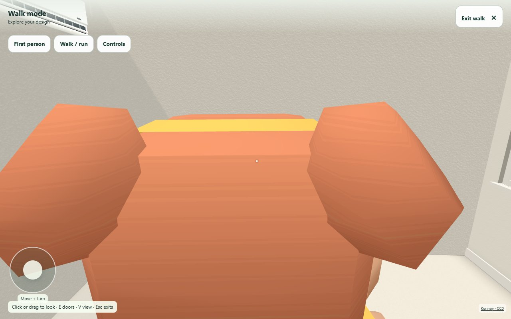
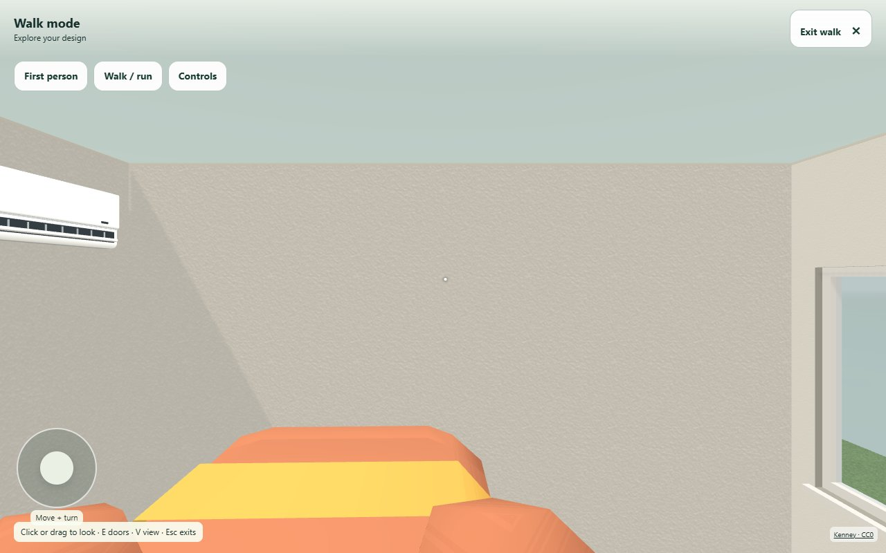
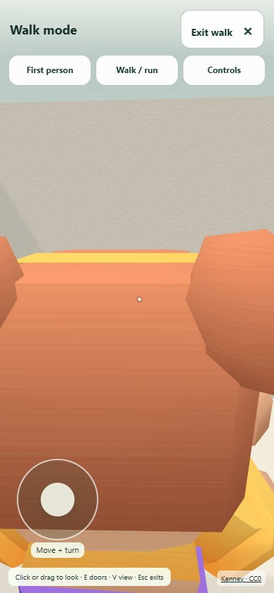
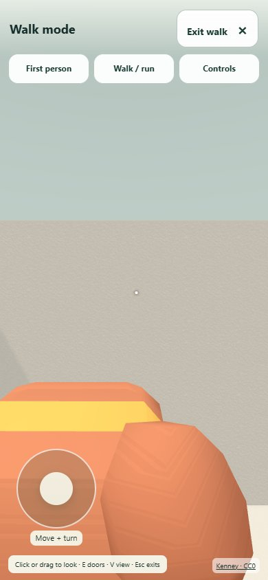

# Walk — World fix round 1

PR [#53](https://github.com/victorcassiusoffice-sketch/ppw-designer-2d/pull/53). Measured code **554fb61eb161a020d3ba5087a14066307aabdc2b**. Date 28 October 2026. Regular CI passes 4,351 tests / 404 files; final documentation-only head is in the handoff. **Not merge-ready under the literal static gate.** No merge/manual deployment authorized.

## Changes and focused proof

Chooser is already in the post-picture launcher; four inline CC0 PNG sizes 1,765/1,820/1,775/1,871 bytes, each 64 × 64. Engine and selected character load only after Start, with visible progress. Four door/view/device combinations and five native Escape cycles pass. DEV-only camera fixture absent from production emitted runtime (string audit); before uses exact 52dfa87 formula in the same current scene.

Final deployed non-forced action→frame with all four decoded thumbnails: **117.0 ms desktop / 237.0 ms phone**: **PASS** against one second on both devices. The original harness's click-call→visible check is **113.0 / 233.0 ms**. DOM-event→decoded-frame timing is **74.3 / 65.4 ms**, recorded separately. Initial code ad78930 failed at 7,386 / 1,363 ms; those results and native-click repeats are retained in walk-performance-initial.json and chooser-diagnostic.json. CPU profiling identified synchronous shader first-use in the AO beauty pass and hidden plan thumbnails. The repair asynchronously warms the matching shader variants before their existing draws, with scene/target restoration and queue-lifetime regressions. Image resolution, lighting, camera, geometry and first-picture scheduling are unchanged. Entry pause remains separate.

Before shader repair, diagnostic repeats on ad78930: desktop/locator: call→visible 4818.0 ms; actual click→visible 49.5 ms; 1 sampled centre-hit failures; desktop/mouse: call→visible 4439.0 ms; actual click→visible 31.1 ms; 1 sampled centre-hit failures; phone/locator: call→visible 1109.0 ms; actual click→visible 240.5 ms; 1 sampled centre-hit failures; phone/mouse: call→visible 1316.0 ms; actual click→visible 113.2 ms; 1 sampled centre-hit failures.

| Device | View | All five input→render samples (ms) | Median | Maximum |
|---|---|---|---:|---:|
| desktop | third | 31.5, 12.6, 20.0, 13.2, 12.5 | 13.2 | 31.5 |
| desktop | first | 5.4, 15.0, 5.1, 28.6, 8.4 | 8.4 | 28.6 |
| phone | third | 10.3, 9.1, 8.2, 15.2, 12.4 | 10.3 | 15.2 |
| phone | first | 43.8, 12.7, 11.8, 7.6, 15.3 | 12.7 | 43.8 |

Input measures event timestamp to render submission, not photons. Entry pause 5.682/3.001 s is separate.

### Same-pose camera pair

Actual furnished demo's narrowest room: Home office 3 × 4 m, x 4.5–7.5 / z 4.5–8.5; feet [5.8,.001,6.2], yaw −π/2, Lea. Local DEV fixture rejects invalid capsules and waits 60 rendered frames. Before/after same scene, character, pose and FOV; only camera algorithm changes. Browser smoke records no errors.

| Before | After |
|---|---|
|  |  |
|  |  |

## Static gate and first-picture network

Controlled build against 3eefbf7 uses identical existing VERCEL_ENV=preview and VERCEL_GIT_COMMIT_SHA=3eefbf7 variables, no configuration changes. App+ThreeStage closure: 28 JS files: **+1968 raw/+744 gzip**. The 45 raw / 12 gzip existing Three aliases count zero by explicit ruling; other adapters remain unexempt. This is a literal **FAIL**, not a rounded-KB pass. Hashed names change transitively; gzip can vary from those hash strings even at identical raw length.

Actual network comparison: **0 separate implementation-chunk requests before picture**, new normalized request paths: **/fonts/fraunces-600-latin.woff2, /fonts/outfit-latin.woff2**. All request starts, including unfinished responses, are included. Observed-file full comparison totals: +3318 raw/+1164 gzip. API response sizes remain variable and are in raw traces.

Unchanged server/brand.ts and middleware.ts serve index.html (PPW) on the specified production vercel.app address, olb.html (OLB) on previews and onelivebuild.com. OLB alone preloads Fraunces and Outfit fonts. Required formal timing URLs were not changed. These two extra request paths are inherited shell routing, not World feature requests. Custom-domain comparisons remain informational.

Against the custom domain, additional normalized request paths: **none**. The controlled same-shell comparison (OLB HTML against OLB HTML, including matching observed JS/CSS/public files) is **+2129 raw / +815 gzip bytes**. The table below maps each actual route to its inherited HTML shell; font files marked “present, not requested” exist in base but were not fetched on its PPW shell. These are completed Vite output bytes after preload transforms, not network compression estimates. The earlier generateBundle-hook audit was superseded because it ran before final Vite transformations. Across the actual requested static assets, including the inherited extra fonts and different HTML shell, the raw-size difference is +52782 bytes; variable API responses are excluded. Original request/response sizes remain in the network JSON. See STATIC-CONSTRAINT.md for the remaining integration requirement.

| Early file / endpoint | Base emitted name | Base bytes / gzip | Candidate emitted name | Candidate bytes / gzip | Raw file delta |
|---|---|---:|---|---:|---:|
| /api/products | API response | network trace | API response | network trace | variable |
| /assets/App.css | assets/App-Xhd2x0gp.css | 207222 / 38005 | assets/App-Xhd2x0gp.css | 207222 / 38005 | 0 |
| /assets/App.js | assets/App-CROjg-sG.js | 1062179 / 327162 | assets/App-DhaYyjZC.js | 1063079 / 327554 | 900 |
| /assets/CurrencySwitcher.js | assets/CurrencySwitcher-DAGBomCy.js | 2642 / 1447 | assets/CurrencySwitcher-jbSTQ-Ik.js | 2642 / 1447 | 0 |
| /assets/DemoDesignerPage.js | assets/DemoDesignerPage-DLqO3W61.js | 4846 / 2371 | assets/DemoDesignerPage-BtVBoEQ4.js | 4846 / 2376 | 0 |
| /assets/LocaleThemeControls.js | assets/LocaleThemeControls-BRZbV6iy.js | 3170 / 1309 | assets/LocaleThemeControls-BfYxxkQy.js | 3170 / 1309 | 0 |
| /assets/RequireMerchant.js | assets/RequireMerchant-BvJGo3r3.js | 5153 / 2292 | assets/RequireMerchant-BvJGo3r3.js | 5153 / 2292 | 0 |
| /assets/ThreeStage.js | assets/ThreeStage-xnIYIUoq.js | 93555 / 32821 | assets/ThreeStage-BZRbvwUo.js | 94564 / 33159 | 1009 |
| /assets/buildSkinStore.js | assets/buildSkinStore-DBtXvGgt.js | 744 / 462 | assets/buildSkinStore-BOOuSSHg.js | 744 / 463 | 0 |
| /assets/buildingServices.js | assets/buildingServices-D7eQkhKr.js | 175717 / 51250 | assets/buildingServices-Bdkk7t0F.js | 175726 / 51256 | 9 |
| /assets/buildingServicesCatalog.js | assets/buildingServicesCatalog-gFhvLWEg.js | 6105 / 2573 | assets/buildingServicesCatalog-gFhvLWEg.js | 6105 / 2573 | 0 |
| /assets/cartStore.js | assets/cartStore-DfhgqqhS.js | 12564 / 4558 | assets/cartStore-8GlfCfOm.js | 12564 / 4553 | 0 |
| /assets/commission.js | assets/commission-BSjTNLTx.js | 52 / 72 | assets/commission-BSjTNLTx.js | 52 / 72 | 0 |
| /assets/currency.js | assets/currency-TeQzs54S.js | 325 / 251 | assets/currency-CKOKboiZ.js | 325 / 251 | 0 |
| /assets/designsApi.js | assets/designsApi-vmM8Eco8.js | 16071 / 5352 | assets/designsApi-BQTp1mpb.js | 16071 / 5349 | 0 |
| /assets/downloadJson.js | assets/downloadJson-DhXa1J4E.js | 276 / 233 | assets/downloadJson-DhXa1J4E.js | 276 / 233 | 0 |
| /assets/embedMessages.js | assets/embedMessages-BIa44F5a.js | 716 / 319 | assets/embedMessages-BIa44F5a.js | 716 / 319 | 0 |
| /assets/main.css | assets/main-CO6GBvCf.css | 73032 / 14288 | assets/main-CO6GBvCf.css | 73032 / 14288 | 0 |
| /assets/main.js | assets/main-DvO__g69.js | 86230 / 31101 | assets/main-DzHQ9fMu.js | 86240 / 31110 | 10 |
| /assets/merchantFurniture.js | assets/merchantFurniture-ZuMdbwJD.js | 2710 / 1372 | assets/merchantFurniture-ZuMdbwJD.js | 2710 / 1372 | 0 |
| /assets/middleware.js | assets/middleware-BoNmX9tp.js | 3758 / 1361 | assets/middleware-BoNmX9tp.js | 3758 / 1361 | 0 |
| /assets/modelSnapshot.js | assets/modelSnapshot-GOA-nC4t.js | 5351 / 2392 | assets/modelSnapshot-Ds6LCYfS.js | 5512 / 2457 | 161 |
| /assets/productImageSafety.js | assets/productImageSafety-CDXX3Z8N.js | 434 / 292 | assets/productImageSafety-CDXX3Z8N.js | 434 / 292 | 0 |
| /assets/productSurfaceLighting.js | assets/productSurfaceLighting-Cl084EKV.js | 37533 / 14014 | assets/productSurfaceLighting-DyXSS9i3.js | 37528 / 14011 | -5 |
| /assets/propertyStore.js | assets/propertyStore-DAzV58D0.js | 88628 / 29835 | assets/propertyStore-0e10hMe0.js | 88628 / 29835 | 0 |
| /assets/quotedProducts.js | assets/quotedProducts-2NCXztC6.js | 392 / 265 | assets/quotedProducts-2NCXztC6.js | 392 / 265 | 0 |
| /assets/renderQualityStore.js | assets/renderQualityStore-DinSqPpH.js | 27262 / 10881 | assets/renderQualityStore-jqKGUHoW.js | 27262 / 10880 | 0 |
| /assets/serviceFixtureMeshes.js | assets/serviceFixtureMeshes-dDaBzpGO.js | 4351 / 1883 | assets/serviceFixtureMeshes-DTCQy3Rs.js | 4351 / 1881 | 0 |
| /assets/showcaseSafety.js | assets/showcaseSafety-DFBXsUeQ.js | 179 / 162 | assets/showcaseSafety-DFBXsUeQ.js | 179 / 162 | 0 |
| /assets/types.js | assets/types-BR-OoGj9.js | 54910 / 12621 | assets/types-BR-OoGj9.js | 54910 / 12621 | 0 |
| /assets/vendor-konva.js | assets/vendor-konva-CbK8OvmD.js | 292561 / 89264 | assets/vendor-konva-CbK8OvmD.js | 292561 / 89264 | 0 |
| /assets/vendor-react.js | assets/vendor-react-CS4MHxMm.js | 142362 / 45622 | assets/vendor-react-CS4MHxMm.js | 142362 / 45622 | 0 |
| /assets/vendor-router.js | assets/vendor-router-YSxUxVSZ.js | 21566 / 8036 | assets/vendor-router-YSxUxVSZ.js | 21566 / 8036 | 0 |
| /assets/vendor-three.js | assets/vendor-three-CjQotlrx.js | 744964 / 191245 | assets/vendor-three-DFSP7WXy.js | 745009 / 191257 | 45 |
| /brand/olb/olb-mark.svg | public/brand/olb/olb-mark.svg | 401 / 269 | public/brand/olb/olb-mark.svg | 401 / 269 | 0 |
| /demo | index.html | 964 / 494 | olb.html | 2153 / 844 | 1189 |
| /fonts/fraunces-600-latin.woff2 | public/fonts/fraunces-600-latin.woff2 (present, not requested) | 17172 / 17200 | public/fonts/fraunces-600-latin.woff2 | 17172 / 17200 | 0 |
| /fonts/inter-variable-italic.woff2 | public/fonts/inter-variable-italic.woff2 | 387976 / 387606 | public/fonts/inter-variable-italic.woff2 | 387976 / 387606 | 0 |
| /fonts/inter-variable.woff2 | public/fonts/inter-variable.woff2 | 352240 / 351777 | public/fonts/inter-variable.woff2 | 352240 / 351777 | 0 |
| /fonts/outfit-latin.woff2 | public/fonts/outfit-latin.woff2 (present, not requested) | 32292 / 32143 | public/fonts/outfit-latin.woff2 | 32292 / 32143 | 0 |
| image/svg+xml;utf8,%3Csvg%20width%3D%2264%22%20height%3D%2264%22%20viewBox%3D%220%200%2064%2064%22%20xmlns%3D%22http%3A%2F%2Fwww.w3.org%2F2000%2Fsvg%22%20aria-hidden%3D%22true%22%3E%0A%20%20%20%20%20%20%20%20%3Ccircle%20cx%3D%2232%22%20cy%3D%2232%22%20r%3D%2220%22%20fill%3D%22%23B6C8B0%22%20stroke%3D%22%235A7A60%22%20stroke-width%3D%222%22%2F%3E%0A%20%20%20%20%20%20%20%20%3Cpath%20d%3D%22M32%2014%20L36%2028%20L50%2028%20L38%2036%20L42%2050%20L32%2042%20L22%2050%20L26%2036%20L14%2028%20L28%2028%20Z%22%20fill%3D%22%235A7A60%22%20opacity%3D%220.4%22%2F%3E%0A%20%20%20%20%20%20%3C%2Fsvg%3E | API response | network trace | API response | network trace | variable |
| image/svg+xml;utf8,%3Csvg%20width%3D%2264%22%20height%3D%2264%22%20viewBox%3D%220%200%2064%2064%22%20xmlns%3D%22http%3A%2F%2Fwww.w3.org%2F2000%2Fsvg%22%20aria-hidden%3D%22true%22%3E%0A%20%20%20%20%20%20%20%20%3Cpath%20d%3D%22M22%2030a10%2010%200%201%201%2020%200c0%205-4%207-4%2012H26c0-5-4-7-4-12z%22%20fill%3D%22%23F6D58A%22%20stroke%3D%22%23B7791F%22%20stroke-width%3D%222%22%2F%3E%0A%20%20%20%20%20%20%20%20%3Crect%20x%3D%2226%22%20y%3D%2244%22%20width%3D%2212%22%20height%3D%225%22%20rx%3D%221.5%22%20fill%3D%22%23B7791F%22%2F%3E%0A%20%20%20%20%20%20%20%20%3Cpath%20d%3D%22M32%208v5M14%2016l3.5%203.5M50%2016l-3.5%203.5M10%2030h5M49%2030h5%22%20stroke%3D%22%23B7791F%22%20stroke-width%3D%222%22%20stroke-linecap%3D%22round%22%2F%3E%0A%20%20%20%20%20%20%3C%2Fsvg%3E | API response | network trace | API response | network trace | variable |
| image/svg+xml;utf8,%3Csvg%20width%3D%2264%22%20height%3D%2264%22%20viewBox%3D%220%200%2064%2064%22%20xmlns%3D%22http%3A%2F%2Fwww.w3.org%2F2000%2Fsvg%22%20aria-hidden%3D%22true%22%3E%0A%20%20%20%20%20%20%20%20%3Crect%20x%3D%2210%22%20y%3D%2226%22%20width%3D%2244%22%20height%3D%2214%22%20rx%3D%223%22%20fill%3D%22%23C0C0C0%22%20stroke%3D%22%23404040%22%20stroke-width%3D%222%22%2F%3E%0A%20%20%20%20%20%20%20%20%3Ccircle%20cx%3D%2218%22%20cy%3D%2233%22%20r%3D%224%22%20fill%3D%22%23404040%22%2F%3E%0A%20%20%20%20%20%20%20%20%3Ccircle%20cx%3D%2246%22%20cy%3D%2233%22%20r%3D%224%22%20fill%3D%22%23404040%22%2F%3E%0A%20%20%20%20%20%20%20%20%3Crect%20x%3D%2222%22%20y%3D%2218%22%20width%3D%2220%22%20height%3D%226%22%20rx%3D%221%22%20fill%3D%22%230E0E10%22%2F%3E%0A%20%20%20%20%20%20%3C%2Fsvg%3E | API response | network trace | API response | network trace | variable |
| image/svg+xml;utf8,%3Csvg%20width%3D%2264%22%20height%3D%2264%22%20viewBox%3D%220%200%2064%2064%22%20xmlns%3D%22http%3A%2F%2Fwww.w3.org%2F2000%2Fsvg%22%20aria-hidden%3D%22true%22%3E%0A%20%20%20%20%20%20%20%20%3Crect%20x%3D%2214%22%20y%3D%2220%22%20width%3D%2236%22%20height%3D%2224%22%20rx%3D%226%22%20fill%3D%22%23E9DCC2%22%20stroke%3D%22%23C0A67E%22%20stroke-width%3D%222%22%2F%3E%0A%20%20%20%20%20%20%20%20%3Crect%20x%3D%2220%22%20y%3D%2214%22%20width%3D%2224%22%20height%3D%2210%22%20rx%3D%223%22%20fill%3D%22%23C0A67E%22%2F%3E%0A%20%20%20%20%20%20%20%20%3Crect%20x%3D%2222%22%20y%3D%2244%22%20width%3D%2220%22%20height%3D%228%22%20rx%3D%222%22%20fill%3D%22%23C0A67E%22%2F%3E%0A%20%20%20%20%20%20%3C%2Fsvg%3E | API response | network trace | API response | network trace | variable |
| image/svg+xml;utf8,%3Csvg%20width%3D%2264%22%20height%3D%2264%22%20viewBox%3D%220%200%2064%2064%22%20xmlns%3D%22http%3A%2F%2Fwww.w3.org%2F2000%2Fsvg%22%20aria-hidden%3D%22true%22%3E%0A%20%20%20%20%20%20%20%20%3Crect%20x%3D%2218%22%20y%3D%228%22%20width%3D%2228%22%20height%3D%2248%22%20rx%3D%224%22%20fill%3D%22%23D8DCE0%22%20stroke%3D%22%236B7480%22%20stroke-width%3D%222%22%2F%3E%0A%20%20%20%20%20%20%20%20%3Cpath%20d%3D%22M18%2026h28M24%2014v6M24%2032v10%22%20stroke%3D%22%236B7480%22%20stroke-width%3D%222%22%20stroke-linecap%3D%22round%22%2F%3E%0A%20%20%20%20%20%20%3C%2Fsvg%3E | API response | network trace | API response | network trace | variable |
| image/svg+xml;utf8,%3Csvg%20width%3D%2264%22%20height%3D%2264%22%20viewBox%3D%220%200%2064%2064%22%20xmlns%3D%22http%3A%2F%2Fwww.w3.org%2F2000%2Fsvg%22%20aria-hidden%3D%22true%22%3E%0A%20%20%20%20%20%20%20%20%3Crect%20x%3D%2220%22%20y%3D%2210%22%20width%3D%2224%22%20height%3D%2226%22%20rx%3D%224%22%20fill%3D%22%233B4A52%22%20stroke%3D%22%230E1B1F%22%20stroke-width%3D%222%22%2F%3E%0A%20%20%20%20%20%20%20%20%3Crect%20x%3D%2216%22%20y%3D%2234%22%20width%3D%2232%22%20height%3D%2210%22%20rx%3D%223%22%20fill%3D%22%233B4A52%22%20stroke%3D%22%230E1B1F%22%20stroke-width%3D%222%22%2F%3E%0A%20%20%20%20%20%20%20%20%3Cline%20x1%3D%2232%22%20y1%3D%2244%22%20x2%3D%2232%22%20y2%3D%2254%22%20stroke%3D%22%230E1B1F%22%20stroke-width%3D%223%22%2F%3E%0A%20%20%20%20%20%20%20%20%3Cpath%20d%3D%22M20%2054%20L44%2054%22%20stroke%3D%22%230E1B1F%22%20stroke-width%3D%223%22%20stroke-linecap%3D%22round%22%2F%3E%0A%20%20%20%20%20%20%3C%2Fsvg%3E | API response | network trace | API response | network trace | variable |
| image/svg+xml;utf8,%3Csvg%20width%3D%2264%22%20height%3D%2264%22%20viewBox%3D%220%200%2064%2064%22%20xmlns%3D%22http%3A%2F%2Fwww.w3.org%2F2000%2Fsvg%22%20aria-hidden%3D%22true%22%3E%0A%20%20%20%20%20%20%20%20%3Crect%20x%3D%228%22%20y%3D%2226%22%20width%3D%2248%22%20height%3D%2220%22%20rx%3D%225%22%20fill%3D%22%23D9B98A%22%20stroke%3D%22%238A6A3F%22%20stroke-width%3D%222%22%2F%3E%0A%20%20%20%20%20%20%20%20%3Crect%20x%3D%2214%22%20y%3D%2218%22%20width%3D%2236%22%20height%3D%2212%22%20rx%3D%224%22%20fill%3D%22%23E8D2AE%22%20stroke%3D%22%238A6A3F%22%20stroke-width%3D%222%22%2F%3E%0A%20%20%20%20%20%20%20%20%3Cpath%20d%3D%22M12%2046v6M52%2046v6%22%20stroke%3D%22%238A6A3F%22%20stroke-width%3D%222%22%20stroke-linecap%3D%22round%22%2F%3E%0A%20%20%20%20%20%20%3C%2Fsvg%3E | API response | network trace | API response | network trace | variable |

## Five interleaved same-host and custom-domain pairs

Base: **https://ppw-designer-2d-nm7fkrg1m-victor-ppw.vercel.app**, healthcheck commit **3eefbf7646f2b5c76e5297f7836e6e0336e8f1a2**, deployment dpl_AyyehKz5CrGnMDEgoUiczUVrRViu. Custom comparisonhttps://onelivebuild.com is informational. Every row new Chromium process/context; no CPU/network throttle; all hosts pinned 216.198.79.3;1280 × 800 and390 × 844touch emulation. No builds/other browsers during timed runs. Whole numbers reproduce the original automation harness; parentheses are canvas render timestamps.

### desktop

| Run | Base vercel.app ms (canvas) | Preview ms (canvas) | onelivebuild.com ms (canvas) | Preview−base ms | Preview−custom ms |
|---:|---:|---:|---:|---:|---:|
| 1 | 4800 (4775.1) | 5664 (5593.7) | 4107 (4045.2) | 864 | 1557 |
| 2 | 5117 (4062.1) | 5163 (5104.1) | 5095 (4056.2) | 46 | 68 |
| 3 | 4999 (4933.6) | 5379 (5291.1) | 4109 (4045.1) | 380 | 1270 |
| 4 | 4283 (4232.2) | 5957 (5892.4) | 5356 (4224.4) | 1674 | 601 |
| 5 | 5637 (4462.4) | 5239 (5156.9) | 4386 (4320.0) | -398 | 853 |

Original harness medians: base **4.999 s**, preview **5.379 s**, custom **4.386 s**. Preview/base **7.6%**, 10% gate **PASS**. Canvas medians **4.462 / 5.291 s** (18.6%; over 10%).

### phone

| Run | Base vercel.app ms (canvas) | Preview ms (canvas) | onelivebuild.com ms (canvas) | Preview−base ms | Preview−custom ms |
|---:|---:|---:|---:|---:|---:|
| 1 | 3876 (3836.1) | 5299 (5225.2) | 3933 (3873.5) | 1423 | 1366 |
| 2 | 3732 (3680.2) | 5432 (5370.3) | 4256 (4177.9) | 1700 | 1176 |
| 3 | 4817 (4786.1) | 5910 (5851.7) | 3781 (3715.2) | 1093 | 2129 |
| 4 | 4231 (4192.0) | 4694 (4639.8) | 4003 (3947.6) | 463 | 691 |
| 5 | 4372 (4352.3) | 5462 (5404.3) | 4058 (3979.6) | 1090 | 1404 |

Original harness medians: base **4.231 s**, preview **5.432 s**, custom **4.003 s**. Preview/base **28.4%**, 10% gate **FAIL**. Canvas medians **4.192 / 5.370 s** (28.1%; over 10%).

### Initial Fix 1 pairs retained before the final shader/focus repairs

Initial code heads: Walk ad78930 and Site 017e16d. These failed samples remain part of the evidence; final rows above do not overwrite them.

### desktop

| Run | Base vercel.app ms (canvas) | Preview ms (canvas) | onelivebuild.com ms (canvas) | Preview−base ms | Preview−custom ms |
|---:|---:|---:|---:|---:|---:|
| 1 | 5310 (5266.9) | 5403 (5379.6) | 5219 (4124.8) | 93 | 184 |
| 2 | 4393 (4323.7) | 5339 (5277.4) | 4395 (3746.7) | 946 | 944 |
| 3 | 4501 (3773.3) | 4716 (4675.1) | 3575 (3542.4) | 215 | 1141 |
| 4 | 3582 (3540.6) | 4734 (4696.4) | 3697 (3652.0) | 1152 | 1037 |
| 5 | 3617 (3568.5) | 4482 (4443.1) | 3752 (3710.8) | 865 | 730 |

Original harness medians: base **4.393 s**, preview **4.734 s**, custom **3.752 s**. Preview/base **7.8%**, 10% gate **PASS**. Canvas medians **3.773 / 4.696 s** (24.5%; over 10%).

### phone

| Run | Base vercel.app ms (canvas) | Preview ms (canvas) | onelivebuild.com ms (canvas) | Preview−base ms | Preview−custom ms |
|---:|---:|---:|---:|---:|---:|
| 1 | 5142 (3795.2) | 11305 (11249.9) | 3805 (3739.9) | 6163 | 7500 |
| 2 | 3624 (3577.9) | 4876 (4832.3) | 3711 (3684.3) | 1252 | 1165 |
| 3 | 3949 (3908.6) | 4360 (4317.8) | 3526 (3483.0) | 411 | 834 |
| 4 | 4339 (3578.0) | 4145 (4106.7) | 4003 (3389.9) | -194 | 142 |
| 5 | 3636 (3597.4) | 4436 (4407.4) | 3549 (3520.7) | 800 | 887 |

Original harness medians: base **3.949 s**, preview **4.436 s**, custom **3.711 s**. Preview/base **12.3%**, 10% gate **FAIL**. Canvas medians **3.597 / 4.407 s** (22.5%; over 10%).

## Gap profile

| Device / target | First picture ms | HTML response end ms | Module evaluation ms | FunctionCall ms | Layout ms |
|---|---:|---:|---:|---:|---:|
| desktop/base | 4104.6 | 430.5 | 28.6 | 2195.5 | 65.8 |
| desktop/walk | 5930.5 | 673.4 | 29.5 | 3269.4 | 81.4 |
| phone/base | 4948.5 | 594.0 | 30.6 | 2813.1 | 49.9 |
| phone/walk | 5105.2 | 668.8 | 29.2 | 2905.6 | 49.7 |

Diagnostic Chrome tracing adds overhead. Event categories can nest; do not add their totals as elapsed time. These samples supplement, never replace, the five retained pairs. Resource timings and exact task records are in profile-walk.json. The first-picture long-task comparison and delivery interpretation are in PROFILE-NOTES.md.

## Lighthouse and CI

Error-level failing assertion IDs identical on main and both candidates (**22**, no additions/removals/changed thresholds or values):

- **/demo?view=2d&pitch=1 (10)**: csp-xss, installable-manifest, label-content-name-mismatch, maskable-icon, robots-txt, splash-screen, themed-omnibox, total-byte-weight, unused-css-rules, valid-source-maps.
- **/pitch/plumbing (12)**: csp-xss, errors-in-console, installable-manifest, maskable-icon, prioritize-lcp-image, robots-txt, splash-screen, themed-omnibox, total-byte-weight, unsized-images, unused-css-rules, uses-responsive-images.

Lighthouse settings/workflow unchanged. Base audited PR #51 head 5a5f4a2 has a tree identical to merge3eefbf7. Regular CI root/API/middleware typechecks, 4,351 tests / 404 files, secrets and Vercel pass. Exact code-run links and final docs CI state are in the handoff.

## Scope and remaining gates

All 30 rubric items re-scored in shared RUBRIC.md; CURRENT/DECISIONS identical both branches. Byte equality remains unmet; timing results above are retained even when slower. Inherited Lighthouse repair, PR #52 absolute targets, satellite/OCR/shadows/shared walk/headset, physical-phone/user studies and new infrastructure were excluded. Existing estimate implementation/tests unchanged; no main push, force-push, merge, manual deploy, migration, new environment/account/key or messages.
